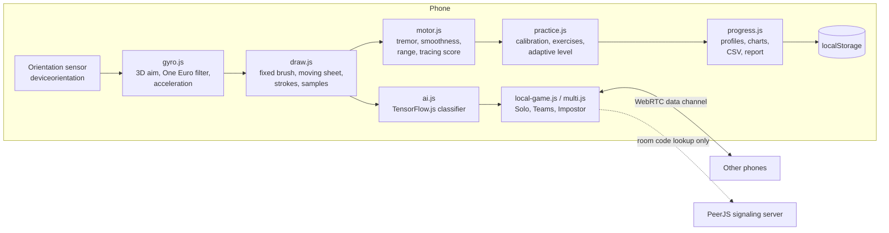

# Architecture

Tilt Sketch is a static web app (no server of its own) served by GitHub Pages. All computation, including AI inference, runs on the phone.

## Modules

| File | Responsibility |
|---|---|
| `js/core.js` | Objects list, pairs, colors, settings state, helpers |
| `js/home.js` | Home screen, settings, camera option |
| `js/gyro.js` | Motion permission, orientation → aim angles, One Euro filter, relative aiming with acceleration, stroke smoothing |
| `js/motor.js` | Resampling at 60 Hz, tremor (high-pass RMS and 4–12 Hz band), log dimensionless jerk, range of motion, tracing coverage and accuracy |
| `js/draw.js` | Drawing loop, camera view rendering, guide shapes, mini-map, turn timing |
| `js/ai.js` | Loads the custom model (`models/tiltsketch`) or the DoodleNet fallback; renders the same 64×64 input as training; scores against the target |
| `js/a11y.js` | Larger text, high contrast, voice guidance, bigger draw button |
| `js/practice.js` | Profiles, range calibration, guided exercises, adaptive difficulty, session summary |
| `js/progress.js` | Progress charts, CSV export, share, printable report |
| `js/local-game.js` | One-phone games with handoff |
| `js/multi.js` | Rooms, QR, lobby, host-authoritative game flow, deadlines, voting |

## Multiplayer protocol

The host phone owns the game state and runs the AI. Messages over WebRTC:

| From → to | Message | Purpose |
|---|---|---|
| guest → host | `hello` | Join with a name |
| host → all | `lobby` | Players, mode, rules |
| host → player | `draw` | Object, time, base strokes (team relay), start mark, auto-start delay |
| player → host | `done` | Strokes and last point |
| host → player | `abort` | Turn deadline passed |
| host → all | `wait`, `board`, `gallery` | Shared screens |
| player → host | `vote` | Impostor vote |

## Data and privacy

Profiles, sessions and settings live in the browser's localStorage. Nothing is uploaded. Exports (CSV, report) happen only when the user taps them. The signaling server only sees random peer IDs, never drawings.
